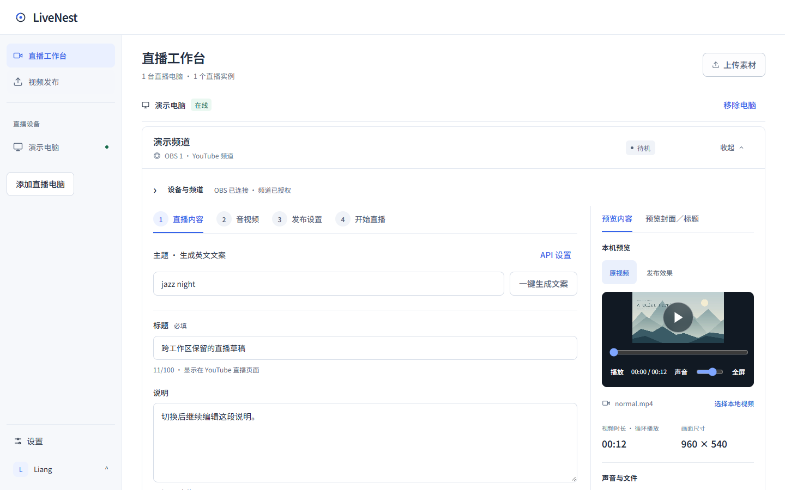
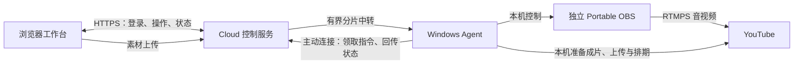

<!-- 文件用途：介绍 LiveNest 的产品能力、使用入口、运行架构与开发方式，并导航到专题文档。 -->
<p align="center">
  
</p>

<h1 align="center">LiveNest</h1>

<p align="center"><strong>多台电脑，多个频道，一个工作台。</strong></p>

<p align="center">在浏览器中编排 YouTube 直播与视频发布，让 Windows 客户端负责执行。</p>

<p align="center">
  <a href="https://livenest.duckdns.org/download">下载 Windows 客户端</a> ·
  <a href="https://livenest.duckdns.org/workspace">打开网页工作台</a> ·
  <a href="#开始使用">开始使用</a> ·
  <a href="docs/README.md">文档</a> ·
  <a href="https://github.com/Doris619619/LiveNest-Releases/releases">发行记录</a>
</p>

<p align="center"><sub>网页工作台 · Windows x64 执行端 · YouTube</sub></p>



<p align="center"><sub>工作台界面示例 · 合成设备与频道数据 · 非真实开播状态 · <a href="docs/工作区切换验收.md">查看验证说明</a></sub></p>

[主要功能](#主要功能) · [开始使用](#开始使用) · [工作原理](#工作原理) · [本地开发](#本地开发) · [部署与升级](#部署与升级) · [遇到问题](#遇到问题)

## 主要功能

你在浏览器中选择素材、编排直播、安排视频发布；Windows 客户端负责独立 OBS 实例、素材处理和实际执行。适合需要集中管理多台直播电脑、多个频道的团队。

本仓库 `LivePilot-v2` 包含网页、Cloud 和 Windows 执行端；对外产品名为 **LiveNest**。

| 能力 | 可以做什么 |
| --- | --- |
| 多电脑、多 OBS | 在网页管理已分配的电脑；每台电脑可配置多个独立 Portable OBS，直播频道按实例隔离。 |
| [直播编排](docs/开播详情配置.md) | 按“素材选择 → 直播编排 → 开播”操作，设置视频、音乐、封面、标题和说明，复用直播配置包。 |
| [视频批量发布](docs/YouTube普通视频发布.md) | 检测本机素材包、选择发布账号、预览日历排期，跟踪准备、上传、处理与公开结果，支持恢复和改期。 |
| [素材上传与预览](docs/发布前预览.md) | 上传到选定电脑和 OBS；检查设备素材的画面、声音与时长，提前准备需要合成的成片。 |
| [AI 文案与观众互动](docs/直播AI观众互动.md) | 生成英文标题和说明，配置直播间文字回复、人设与接话规则；AI 服务需要可用的服务配置。 |
| [团队管理与故障恢复](docs/故障恢复帮助.md) | 客户管理自己的设备，管理员协助操作并查看审计记录；提供配额数据台、状态核对和按原任务恢复的入口。 |

结束直播和取消未完成上传前会核对操作；编辑中的设置、发布内容和改期表单提供未保存保护。发布与管理员视图的筛选、分页和日期可通过地址恢复。修复范围、浏览器回归命令和真实环境验证边界见[界面规范修复与验收](docs/界面规范修复与验收.md)。

## 开始使用

| 你的目标 | 从这里开始 |
| --- | --- |
| 使用已有 LiveNest 服务 | [安装 Windows 客户端](https://livenest.duckdns.org/download)，按下面的步骤连接电脑与频道。 |
| 为自己的团队部署服务 | 阅读[从零部署](docs/从零部署.md)，准备 Cloud、域名和执行机。 |
| 查看界面或参与开发 | 跳转到[本地开发](#本地开发)，使用独立示例数据运行预览。 |

### 准备条件

- 一台用于执行直播或发布任务的 **Windows x64 电脑**，以及可登录工作台的浏览器。
- 管理员分配的客户账号。管理员通过网页管理客户和设备，Windows 客户端使用客户账号登录。
- 具有所需直播或上传权限的 YouTube 频道；频道持有人需亲自完成 Google 授权。
- 本机视频、音乐和足够的磁盘空间、编码资源与上行带宽。可同时运行的路数取决于电脑和网络条件。

安装版已包含 Node、Agent、Portable OBS 和离线帮助，直播电脑无需另装 Node、Git、Docker 或 OBS。

### 第一次直播

1. **安装客户端。** 从[下载页](https://livenest.duckdns.org/download)获取 Windows 安装器，分别选择程序安装位置和 LiveNest 数据保存位置。
2. **准备 OBS。** 登录客户端，在“设备配置”中点击“准备第一个 OBS”，按步骤完成本机检查。
3. **连接网页。** 在工作台添加直播电脑，将配对码填入客户端。一台电脑只需配对一次，后续可继续添加独立 OBS。
4. **授权并准备素材。** 在网页选择对应电脑和 OBS，授权频道，再上传或选择这一路的视频与音乐。不同直播实例必须绑定不同频道。
5. **编排并开播。** 填写标题、说明和封面，确认本场配置与检查结果后主动开始直播，并在 YouTube 观看端核对音画。

完整操作、已有 OBS 接入及数据目录迁移见[桌面配置与网页协作](docs/桌面配置与网页协作.md)。**“设备在线”表示 Agent 已连接云端，不等于 OBS 已连接或直播已开始。**

### 批量发布普通视频

在所选电脑的 LiveNest 数据根目录准备发布包：

```text
Publishing/Inbox/
└── 我的批次/
    └── 001/
        ├── video.mp4
        ├── cover.jpg         # 可选
        ├── title.txt         # 可选
        └── description.txt   # 可选
```

网页进入“发布视频”，按 **检测并检查素材 → 配置与排期 → 确认计划 → 自动执行** 操作。发布账号独立授权，可与直播使用不同频道；实际 Inbox 路径可从网页复制，也可在客户端直接打开。

需要配乐合成时，在数据根的 `tools` 目录放置配套的 `ffmpeg.exe` 与 `ffprobe.exe`，或通过 PATH 提供。合成和视频上传由目标电脑执行。素材包格式、发布状态、改期与恢复说明见[普通视频发布指南](docs/YouTube普通视频发布.md)。

## 工作原理



- **Cloud** 负责账号、设备归属、指令派发与状态。客户只能操作分配给自己的设备，管理员协助操作留有审计记录。
- **Windows Agent** 主动向云端建立连接，负责完整直播流程、YouTube 令牌、本机媒体与视频发布；OBS 控制端口无需暴露到公网。
- **每个 OBS 实例** 使用独立目录和频道绑定，以 `LIVE` 场景及 `VIDEO`、`MUSIC` 媒体源执行直播。直播音视频直接从 OBS 推送到 YouTube。
- **素材处理** 在目标电脑完成。Cloud 可中转上传分片，不承担云端 FFmpeg 转码或直播音视频转发；浏览器不接收 OBS 密码、OAuth 密钥、令牌或推流密钥。

架构与协议详见[多电脑云端与 Agent](docs/多电脑云端与Agent.md)、[远程控制与素材上传](docs/远程控制与素材上传.md)和[本地核心架构](docs/ARCHITECTURE.md)。

## 本地开发

开发需要 Git、仓库读取权限，以及 **Node.js 22.23+（22 系列）或 24+**。以下命令启动独立的示例数据预览：

```powershell
git clone https://github.com/Doris619619/LivePilot-v2.git
cd LivePilot-v2
npm ci
npm run build
npm run desktop:renderer
npm run preview:local
```

打开 <http://127.0.0.1:3020> 查看工作台和桌面配置示例，按 `Ctrl+C` 结束。此预览使用合成设备与频道，不会实际开播，默认不调用真实 AI。

提交前运行 `npm run verify`。真实账号只读预览、环境配置、源码目录及常用命令见[开发指南](docs/开发指南.md)；贡献代码请遵循[工程协作规范](docs/工程协作规范.md)和 [PR 规范](docs/PR撰写规范.md)。

## 部署与升级

**使用已有服务**：通过网页和 Windows 安装版操作即可，无需自行部署 Cloud。

**部署自己的服务**：按照[从零部署](docs/从零部署.md)准备 Linux 服务器、HTTPS 域名、Google 项目与 Windows 执行机。文档涵盖环境初始化、配对、部署检查和回退；旧本地模式及配置兼容见[本地模式与多实例](docs/本地模式与多实例.md)。

**升级现有环境**：按发行记录协调 Cloud、网页与 Agent 版本，保留原数据目录、设备身份和频道授权。需要新 Agent 能力的功能，须升级对应电脑的客户端。

当前仓库版本为 **0.1.19**。已公开安装器见[发行页](https://github.com/Doris619619/LiveNest-Releases/releases/latest)，源码、安装包和部署证据见 [0.1.19 发布记录](docs/desktop/0.1.19发布.md)。历史版本与专项验证集中在[文档中心](docs/README.md#版本与交付)。源码更新、安装包发行和客户设备升级分别记录，不互相代表。

## 遇到问题

### 常见问题

**操作网页的电脑也需要装 OBS 吗？** 只在实际执行直播的 Windows 电脑安装客户端。远程操作使用浏览器；安装版包含 Portable OBS 和 Agent。

**一台电脑能运行几路？** 可以添加多个独立 OBS，每个直播实例绑定不同频道；实际同时运行的路数取决于编码器、CPU、内存与上行带宽，需在目标电脑验证。

**素材和视频在哪里处理？** 素材上传到所选执行机，配乐合成与视频上传也在该电脑完成；Cloud 负责操作与状态，并中转有界上传分片。

### 故障排查

| 现象 | 优先检查 |
| --- | --- |
| 电脑离线或连接中断 | 打开对应电脑的客户端，检查网络与连接状态；普通断网无需删除设备或重新配对。 |
| OBS 未连接 | 对目标实例执行“重新检查”，查看其进程、端口和控制连接结果；不要仅凭设备在线判断。 |
| 开停播结果不确定、素材无法修改 | 使用“重新检查／查询本次操作”核对原场次，再按页面提供的恢复步骤处理。 |
| YouTube 配额不足 | 管理员查看“总览 → YouTube 配额”；反复授权或重试不能补充项目配额。 |
| 上传或发布中断 | 从原文件或原批次的恢复入口继续，先核对远端结果，避免重复创建上传。 |

详细步骤见[故障恢复帮助](docs/故障恢复帮助.md)。报告问题时附上客户端版本、操作步骤和脱敏诊断摘要，不附密码、令牌或原始 OAuth 请求。协议、配额和异常恢复的技术证据见[文档中心](docs/README.md#故障恢复与验证)。
