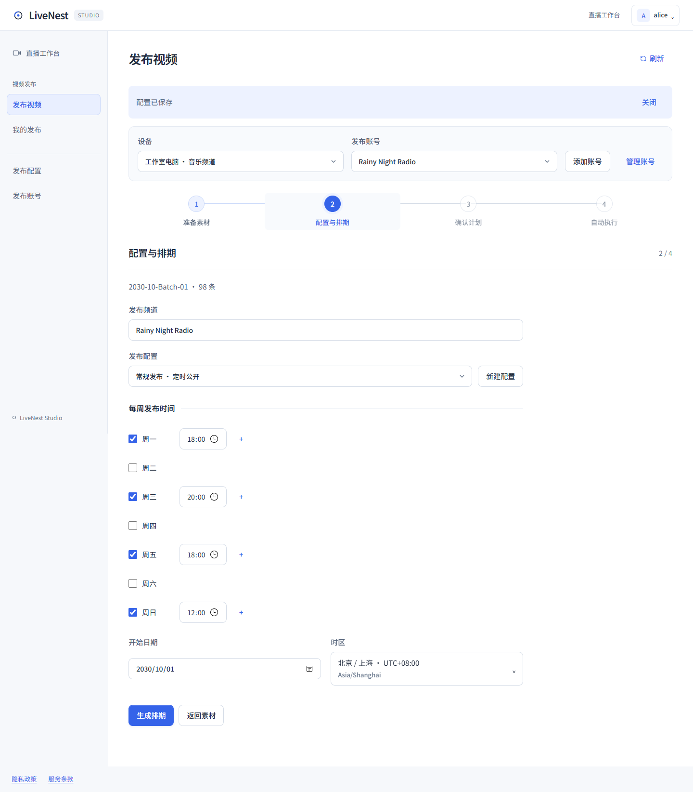

<!-- 文件用途：记录 0.1.14 素材预览、发布导航及网站/安装器的正式交付证据。 -->
# LiveNest 0.1.14

状态：发布准备中，尚未创建正式标签、公开安装器或切换网站。已授权审计通过后发布；以下状态按实际结果更新。

## 用户可见变化

- 发布包、确认计划和编辑弹窗接入设备素材预览。编辑默认展开但不自动播放，直接继承已配置的标题、频道、封面与音乐。
- 点击画面播放/暂停，检查实际时长、音轨、抽样/完整解码结果；支持取消检查、试听发布效果及准备最终成片。
- 左侧直接进入“发布配置”和“发布账号”；第 2 步改为“配置与排期”，确认页可明确返回该步骤。切换导航保留原发布草稿。
- 包含自 0.1.13 后已合并的发布批次状态与明确再次发布、工作台交互层级及 AI 配置恢复修复（PR #30、#34），以及预览功能与审计修复（PR #35）。

## 配套与数据边界

Cloud 与 Agent 需配套升级，旧 Agent 保留原发布/开播能力并提示升级预览。新 Agent 连接旧 Cloud 时对新增能力的 400 拒绝进行一次兼容回退。Cloud 中转目前限单 Node 进程，媒体仅有界暂存；FFmpeg 与最终成片准备运行在 Agent。

保留现有账号、设备身份、发布计划、授权、OBS 和素材。部署只切换网站程序，保留前一发行及备份；不恢复旧业务数据、不强制升级客户设备、不执行真实 OAuth、上传或开播。预览本机素材不等于 OBS 实际输出。

## 发布前验收

- PR #35 功能代码：108 个测试文件、1039 项测试、8 项部署检查及 Linux/Windows、NSIS 安装/升级/保留数据卸载 CI 已通过；隔离 Agent 实际 HTTP/FFmpeg 验收 16 项通过。
- 当前 0.1.14 导航与版本变更：`npm run verify` 通过（108 个文件 / 1039 项测试，8 项部署检查，Cloud/Agent 构建）。四步发布浏览器回归通过，覆盖 100 个合成发布包、320/390/1024/1440 布局、配置/账号切换保留草稿及旧 Agent 升级提示不阻塞编辑；媒体预览 7 组浏览器回归通过。版本 PR 与当前 head 的 CI 待完成。
- 正式标签、公开安装资产、网站同版下载、Cloud 切换与公网检查：待执行。
- 真实客户设备升级、扬声器听感、YouTube 上传/接收画面：未验收，不以合成数据或 CI 代替。

## 材料

- [发布前预览与验收](../发布前预览.md)
- [媒体中转和部署限制](../媒体预览中转.md)
- [普通视频发布](../YouTube普通视频发布.md)
- [桌面安装与发布流程](../桌面安装与发布.md)

下图来自本地合成数据，展示直接配置入口和“配置与排期”步骤，不代表生产设备验收。

