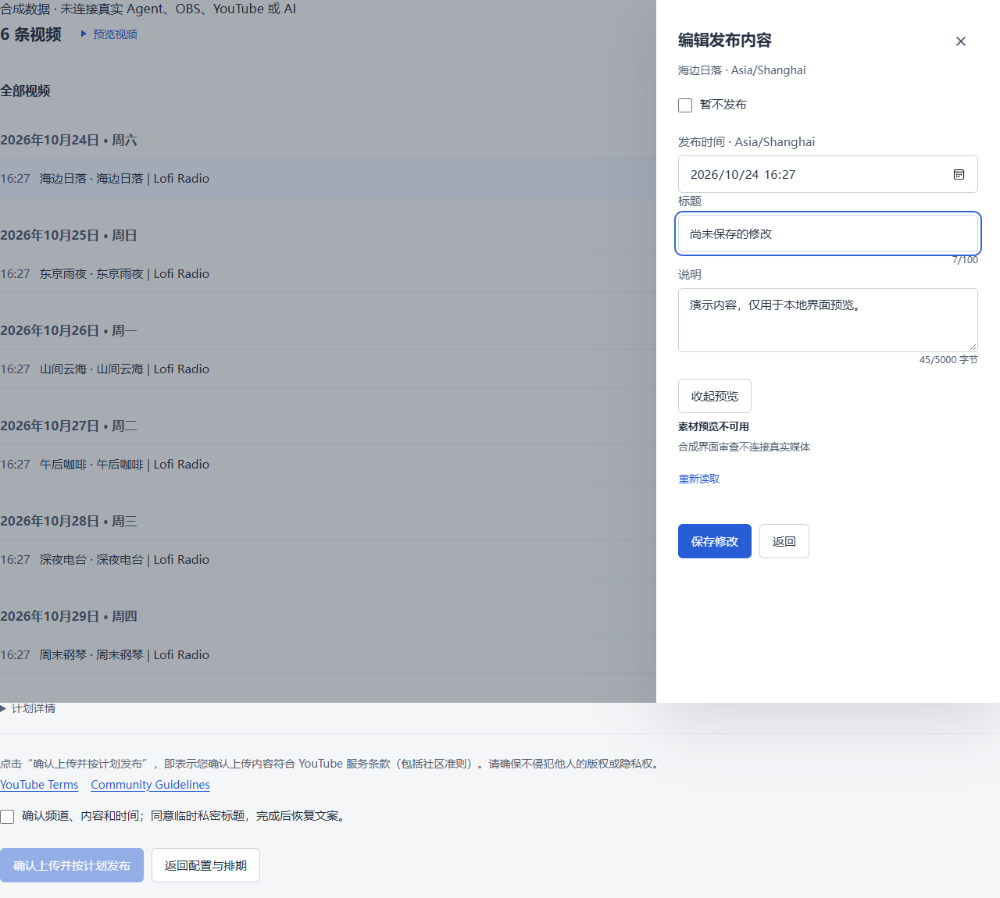
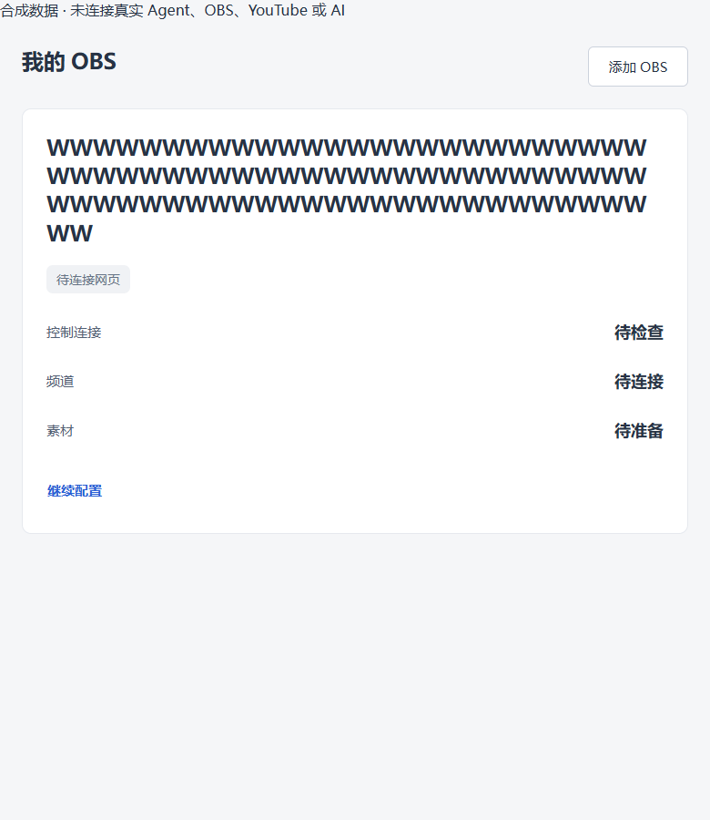
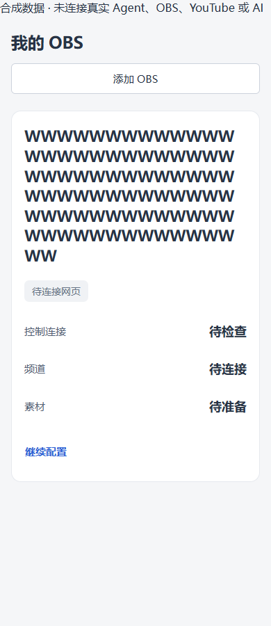

<!-- 文件用途：追踪 Web Interface Guidelines 审查的29组修复、回归入口、示例截图与真实环境验收边界。 -->
# 界面规范修复与验收

本次以 `main@8ebcc83` 的审查为起点，修复网页工作台、视频发布、管理员数据台和 Windows 桌面界面的 29 组问题。核对依据为 [Web Interface Guidelines](https://raw.githubusercontent.com/vercel-labs/web-interface-guidelines/main/command.md)，框架行为按仓库安装的 Next.js 16.3.8 文档及实现确认。

## 使用行为

- **危险操作**：网页结束直播前显示频道、电脑、OBS 与场次确认；取消上传前说明目标和临时数据删除。取消确认不会发送控制或删除请求；已确认结束的场次仅解锁素材，不再重复询问结束场次。
- **编辑保护**：设置、发布内容、改期与修复表单在刷新或离页前保护未保存输入；本地设备/账号/频道切换也检查下层草稿。配额政策跨日期保留，基线按日期分别保留。密钥和表单草稿不写入 URL 或持久浏览器存储。
- **地址恢复**：发布与管理员的可分享视图、筛选、分页、详情、日历和日志日期进入查询参数；普通点击保留工作区，顶层发布导航支持复制链接、新标签和中键。已有 `customer`、OAuth 结果参数和 hash 不因修改筛选而被覆盖。
- **输入与键盘**：中文输入法确认不触发试聊；标签可以逐字输入多个值；修改时间不会把焦点留给另一个时间槽。字段错误就地关联并聚焦，配置包编辑、保存和返回恢复焦点。
- **规模与布局**：批次、已有记录和单日排期分页，视频模板目录每页 20 项；长实例名可换行，桌面提供跳到正文入口。

## 29 组闭环

| 编号 | 优先级 | 修复及主要位置 | 验证入口 |
| --- | --- | --- | --- |
| F01 | P1 | `instance-console.tsx`：结束直播前确认目标和场次 | UI 回归分别取消、接受确认，核对请求数 |
| F02 | P2 | `upload-panel.tsx`、`upload-recovery.tsx`：删除临时上传前确认 | UI 回归取消不发 DELETE、接受只发一次 |
| F03 | P2 | `publishing/profile-editor.tsx`：标签保留原始文本，提交时解析 | UI 逐字输入与发布输入单测 |
| F04 | P2 | `live-chat-preview.tsx`：两个入口均排除组合输入 | full/compact 输入法与普通 Enter 对照 |
| F05 | P2 | `publishing/package-setup.tsx`：编辑时不按时间值重排控件 | UI 焦点和值、输入顺序单测 |
| F06 | P2 | 发布计划、策略、改期、修复：关闭与上下文替换保护草稿 | UI 关闭取消、历史遍历；发布单测 |
| F07 | P2 | `use-unsaved-changes.ts`、设置 Provider：原生离页、站内导航和历史保护 | UI 离页、设置 dirty、保存清理与旧浏览器分支 |
| F08 | P2 | `admin/youtube-policy.tsx`：项目政策及分日基线草稿 | UI 切日往返保留输入 |
| F09 | P2 | `youtube-policy-model.ts`：边界与 schema 对齐，中文错误关联字段 | 预算边界单测、UI 原生约束与关系错误焦点 |
| F10 | P2 | `admin/accounts.tsx`：恢复输入可用后再聚焦错误字段 | UI 合成 ACCOUNT_EXISTS 响应 |
| F11 | P2 | `api-key-settings.tsx`：字段错误、ARIA 与焦点 | UI 无效密钥不提交并聚焦 |
| F12 | P2 | `publishing-profile-settings.tsx`：进入、返回、放弃及保存回焦 | 组件 UI 回归 |
| F13 | P2 | 发布主导航、历史、日历、计划与执行页码进入 URL | URL 单测、组件与 Next 整页回归 |
| F14 | P2 | 管理员页签、搜索、范围、配额日志、时段和分页进入 URL | 查询白名单单测、Next 整页回归 |
| F15 | P2 | 发布批次选择每页 25 条，当前页计算数量；越界计划页码按实际总数钳制 | 发布单测与越界链接 UI 回归 |
| F16 | P2 | 已有记录、单日执行及月历展开按页渲染；关闭详情不挂载长清单；确认放弃后翻页清除草稿 | 万项记录/单日分页单测、执行清单 UI 回归 |
| F17 | P2 | 桌面标题与管理员设备名允许收缩、断词和换行 | 实际组件 780/390px 示例截图 |
| F18 | P2 | 桌面与帮助导航提供当前项语义 | 源码、类型检查和构建 |
| F19 | P3 | API 重读保留密钥和已触碰用途，未改字段同步最新值 | 组件 UI 的外部更新与草稿合并 |
| F20 | P3 | 视频模板每页 20 项，翻页及编辑后回焦 | UI 200 项目录和保存回原页 |
| F21 | P3 | 发布离散阶段在常显主行使用唯一 polite live region；百分比不重复播报 | 发布阶段单测、折叠详情下的 UI 语义回归 |
| F22 | P3 | 移除 `grid-template-rows` 过渡，保留既有 reduced-motion | CSS 复核及界面检测 |
| F23 | P3 | 非模态 Popover 增加滚动边界隔离 | CSS 复核及界面检测 |
| F24 | P3 | 公共装饰图标默认 `aria-hidden`，有意义图形可显式覆盖 | 组件 UI 和调用复核 |
| F25 | P3 | 相关表单补齐 name、autocomplete，标识符关闭 spellcheck | 类型检查、ESLint、组件 UI 与源码复核 |
| F26 | P3 | 登录仅精确指针环境自动聚焦 | 媒体条件与焦点代码复核 |
| F27 | P3 | 离线帮助图使用真实图片尺寸 | 图片尺寸与布局代码复核 |
| F28 | P3 | 桌面主界面增加跳到正文链接 | 语义、焦点样式与构建 |
| F29 | P3 | 发行日期、大小与相关配额显示使用 Intl，时区/跨日明确 | 时区单测、类型检查与显示代码复核 |

## 实现与兼容

`use-url-state.ts` 通过稳定字符串快照订阅浏览器地址。History API 写入传 `null`，让 Next 自行复制内部历史标记并同步 canonical URL；直接把 Next 的 `__NA` 状态传回会跳过该同步，因此不能照搬原状态。连续更新不同查询字段始终读取最新地址。

查询中的 `publishing-*` 承载发布视图、筛选、分页、日历与步骤；`admin-*` 承载管理员页签与搜索；`usage` 只解析白名单日志字段。输入搜索使用 replace，离散视图切换使用 push。设备或账号切换清除上个上下文的显式向导步骤，仍按各自原有草稿恢复。

未保存保护只注册 dirty 标记。支持 Navigation API 时在导航前确认；其他浏览器给应用加载后的历史条目附加序号，在捕获阶段取消跳转后回到原条目，保留前进历史。若遇到应用加载前没有序号的旧条目，仅恢复当前地址与编辑器并保留前进分支，无法保证回到原条目的位置。完整刷新与关页使用浏览器原生提示。表单本地关闭和会销毁子表单的设备、账号、频道切换另有显式确认；普通视图切换优先保持挂载。

旧浏览器的 `popstate` 监听在模块初始化时注册，未编辑时不拦截。该事件以 `window` 为目标，同一目标上的捕获监听不会越过更早注册的 Next 监听器；仅在 dirty 后才注册会让 Next 先覆盖原位置。因此还限制历史替换对受保护位置的更新，并用真实 Next 生产页面验证此顺序。

本次不改变 Cloud/Agent 控制协议、授权凭据、媒体处理或 OBS 配置。网页修复需发布网页版本；桌面修复需重新构建并分发安装器。PR 创建不代表已部署或已升级客户设备。

## 命令与证据

```powershell
npm run verify
npm run test:ui-guidelines
```

后一个命令直接打包当前源码组件，并启动隔离的 Next 生产服务，均仅监听 loopback；先运行 `verify` 生成生产构建。所有设备、账号、直播与 AI 响应均为合成数据。未知外部请求被拒绝；测试不会调用真实 Agent、OBS、YouTube、OAuth 或收费模型。Windows 使用本机 Edge，Linux CI 安装 Playwright Chromium。

需要更新示例截图时，先将 `WEB_GUIDELINES_SCREENSHOTS` 设置为 `docs/screenshots/interface-guidelines` 再运行。测试截图必须保留“合成数据 · 未连接真实 Agent、OBS、YouTube 或 AI”标记。







本地完整 `npm run verify` 通过：TypeScript、零 warning ESLint、151 个测试文件的 1,568 项测试、14 项存储锁测试、8 项部署测试、Next 生产构建和 Agent 构建全部完成。`npm run desktop:renderer` 的桌面静态生产构建通过。`npm run test:ui-guidelines` 的四段回归覆盖 19 组操作保护/输入/URL 场景、设置与 200 项模板目录组件、3 组发布分页与播报场景，以及 4 组 Next 整页导航/刷新/旧浏览器兼容场景；页面错误为空。对应 CI 以 PR 当前提交的检查状态为准。

既有 `tests/workbench-ui.smoke.mjs` 在隔离 Next 生产服务上通过：工作区草稿、步骤、滚动和历史恢复，桌面/手机导航、账号隔离，以及 17 MiB 合成文件跨工作区上传（一次创建、三个分片、一次完成、零中止）。该文件的上传准备响应已补齐当前准入协议，未改变产品上传逻辑。

界面静态检测仅保留原有 `desktop/app/desktop.css` 中 `.setup-feedback` 的边框强调提示，本次没有新增该样式。

首次完整验证的隔离临时目录位于 C 盘，实际剩余空间不足，上传与数据迁移测试触发空间保护而失败。保留原始失败记录后，将本次工作树及 `TEMP/TMP` 放在 D 盘重新执行；随后构建遇到本机虚拟内存不足，设置 `NODE_OPTIONS=--max-old-space-size=2048 --max-semi-space-size=8`、`CIRCLE_NODE_TOTAL=3`、`RAYON_NUM_THREADS=2` 限制资源后完整验证通过。未降低磁盘保护阈值、跳过类型检查或放宽原断言。

未验证：真实手机软键盘、真实读屏软件、已部署站点、打包后的桌面安装器、真实 OAuth、实际开停播、客户设备升级和最大规模列表的性能压测。组件回归、Next 整页模拟、单元测试与构建分别提供证据，不替代这些真实环境验收。
