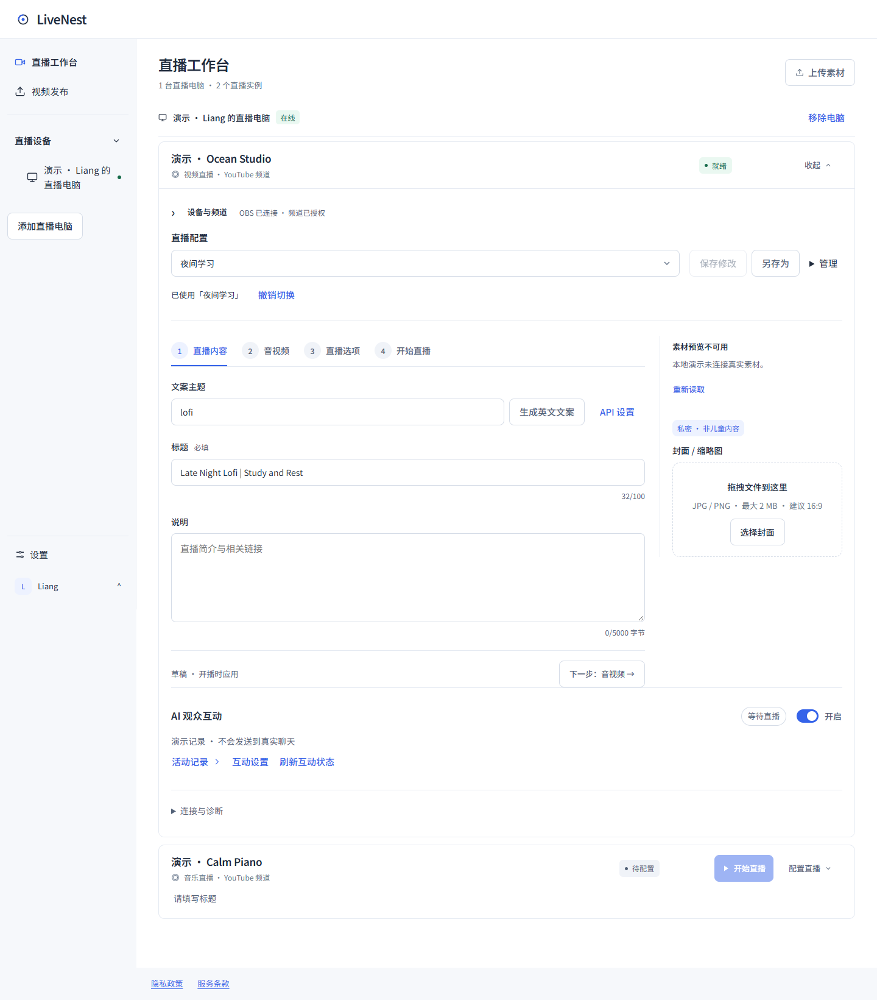

<!-- 文件用途：说明直播命名配置的操作、持久化边界、权限和本地验收证据。 -->
# 直播配置复用

直播实例顶部新增「直播配置」，将一套常用内容保存后，在后续场次选择复用。视频侧的对应功能命名为「视频发布配置」，两者独立；直播第 3 步改名为「直播选项」。

## 使用方式

1. 编辑本场的直播内容、音视频和直播选项，点击「另存为」，输入名称并保存。
2. 在下拉框选择已保存配置，确认「使用配置」后填入当前草稿；「保留当前草稿」取消切换，应用后可「撤销切换」。
3. 修改当前配置后显示「本场有未保存的修改」；「保存修改」更新当前方案，「另存为」保留原方案并创建新方案。
4. 「管理」可重命名或删除。重命名只改配置名称；删除不会清空当前草稿、删除素材或影响已运行的直播。

配置加载和列表刷新从不自动替换当前草稿；应用配置只填表，不开播、不调用付费生成、不重新上传素材。直播或待核对场次继续使用原有锁定机制。

## 保存内容与隔离

| 保存 | 不保存 |
| --- | --- |
| 标题、说明 | API Key、OAuth、OBS 连接信息 |
| 视频、音乐文件名及视频原声开关 | 文件字节、绝对路径 |
| 封面标识和名称 | 封面原始图片 |
| 公开范围、儿童内容、播放列表 | AI 互动长期偏好、直播运行状态 |

配置允许标题和素材暂留空，以便先保存常用选项；真正开播仍要求有效标题和存在的音视频。引用素材被移走或封面失效时，沿用原有选择器和 Agent 校验，不静默换成其他素材。每个目标最多保存 50 套，名称最长 60 字，同一目标名称不能重复。

Cloud 将配置保存到自身数据目录的 `broadcast-profiles/<scope hash>/profiles.json`。scope 由设备所有者、电脑、实例和已确认频道组成；本机模式仅允许管理员，并保存在对应实例目录。所有读写先检查账号、设备归属和实例，再核对服务端频道。换绑频道或转移设备所有者不继承原配置；管理员可协助当前所有者，写操作记录动作与目标，不记录文案或凭据。

写入使用短文件事务和修订号。并发修改返回冲突，保留浏览器草稿；重新读取列表后可决定是否保存。响应丢失的相同请求可安全重试，不重复创建配置。原有 sessionStorage 草稿、Agent 配置、主实例授权文件和已确认的视频发布快照不迁移。

## 名称对应

| 入口 | 名称 | 范围 |
| --- | --- | --- |
| 直播实例顶部 | 直播配置 | 命名保存的可复用直播内容与选项 |
| 直播第 3 步 | 直播选项 | 当前场次的公开范围、观众和播放列表 |
| 视频发布 → 配置与账号 | 视频发布配置 | 视频文案模板、AI 规则、公开范围等规则 |
| 视频发布流程 | 配置与排期 | 选择视频发布配置并安排本批时间 |

## 验收边界

- `npm run verify`：包含真实文件事务的配置接口集成测试，验证多套保存、重新读取、修订冲突、删除、名称重复、非法字段/路径、账号/实例/频道/设备归属隔离及管理员审计。
- `node tests/broadcast-profiles-ui.smoke.mjs`：连接本地隔离预览的真实配置 API，验证另存为、选择/取消/撤销、更新、重命名、删除、模拟保存失败、新浏览器上下文读取、并发冲突保留草稿、模块切换及 1440/390/320 宽度。
- 设置迁移、视频发布和工作区连续性脚本作为回归，仍使用合成设备；工作区慢分片上传是模拟上传。
- 本机预览的其他业务为演示数据。未进行真实 OAuth、OBS 开播、YouTube 发布、付费 AI 调用或真实素材上传。预览重启创建新的隔离数据目录；正式服务使用固定数据目录持久保存。
- 本功能无需新增 Agent 协议；Cloud/网页更新后，沿用支持直播详情的既有 Agent。尚未合并或部署，安装版不因本次 PR 自动升级。

本次已完成：完整 `npm run verify`（109 个测试文件 / 1046 项测试、8 项部署测试、类型检查、Lint、Next 和 Agent 构建）；配置浏览器验收、设置迁移、视频发布和工作区连续性回归全部通过。Impeccable 对新增工具条及直播表单扫描无发现；桌面和 390/320px 检查无横向溢出，页面无未捕获异常。

以下均为合成设备与配置；配置保存和读取使用真实隔离 API：

[390px 布局](screenshots/live-profiles/workspace-390.png) · [320px 布局](screenshots/live-profiles/workspace-320.png) · [视频发布配置名称](screenshots/live-profiles/video-profile-names.png) · [测量记录](screenshots/live-profiles/measurements.json)
