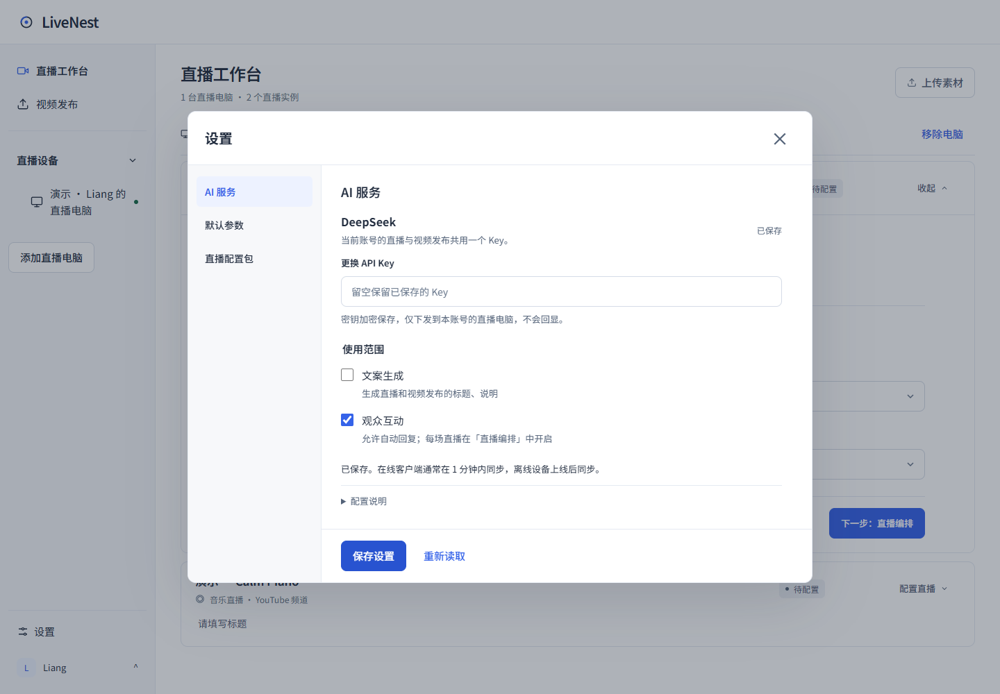
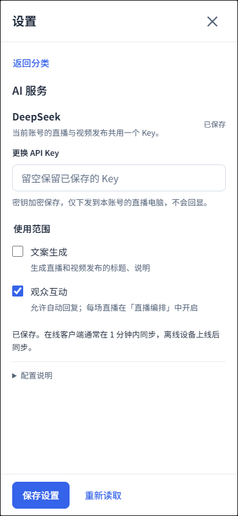
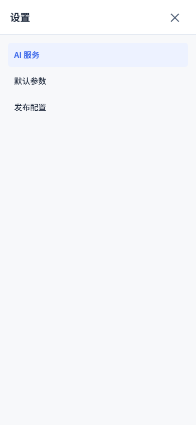
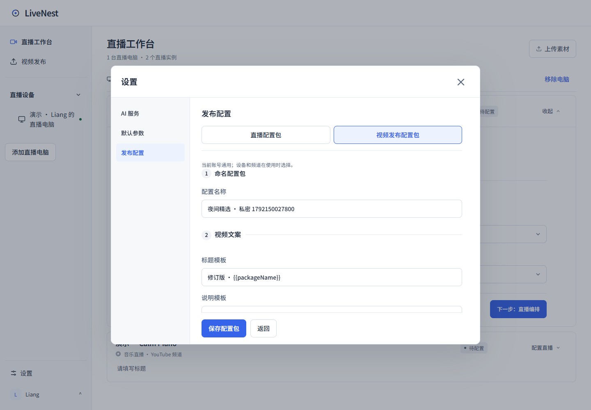
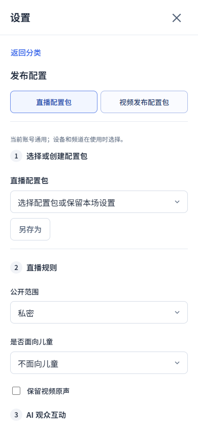

<!-- 文件用途：记录客户设置中心的布局、草稿边界、成熟设计参考与隔离浏览器验收。 -->
# 设置中心验收

## 结构与参考

参考 [Linear 的分类设置](https://linear.app/docs/account-preferences)、[Notion 的账号与偏好归属](https://www.notion.com/help/account-settings)，沿用 LiveNest 品牌与分类设置结构，不复制产品专有视觉资产。滚动和固定操作区参考 [Carbon Modal](https://carbondesignsystem.com/components/modal/usage/)。900 × 680 是本项目的桌面尺寸选择，不是引用产品的固定规格。

- 桌面窗口最大 900 × 680 CSS 像素，小屏保留 24 像素边距；分类、加载结果和错误不改变外框尺寸。
- 左侧为 AI 服务、默认参数、发布配置；右侧标题固定，仅正文滚动。两类配置包均为当前登录账号通用，不显示配置对象。
- AI 服务、默认参数的提交操作固定在当前分类底部；配置包的保存、重命名等操作仍靠近配置选择器。
- 600 像素及以下使用全屏分类/详情视图；返回分类和选择分类时将键盘焦点移到可见区域。窄屏不并排挤压导航与表单。
- 表单在分类切换时保持挂载，保留输入、展开状态及滚动位置；隐藏页不参与键盘与读屏导航。
- 有未保存的修改时，关闭按钮、Escape 和外部点击统一提示；可继续编辑或放弃并关闭。保存期间保持关闭和分类切换锁定。

## 发布配置

- 「发布配置」集中管理直播配置包和视频发布配置包，按当前登录账号隔离，不绑定设备和频道。
- 直播按 1 选择或创建配置包、2 直播规则、3 AI 观众互动排列。
- 视频按 1 命名配置包、2 视频文案、3 发布方式、4 补充设置排列。列表阶段第 1 项为选择或创建配置包。
- 编号表示表单阅读顺序，不增加强制逐步跳页。类型切换保留编辑内容及滚动位置；设备、发布频道、播放列表与固定封面文件在实际使用时选择。
- 视频原侧栏及发布向导中的「管理配置包」都打开同一个设置窗口。保存采用原 API 与修订校验；通知工作台刷新列表，不自动替换当前选择或已确认的计划快照。
- 视频保存失败保持表单；返回列表前检查未保存修改，关闭窗口仍使用统一丢弃保护。

## 数据边界

草稿只保留在本次打开的设置窗口内存，关闭后销毁，API Key 不写入浏览器持久存储。保存仍使用原账号/目标权限与修订号，不因为切换分类产生写请求。切换配置对象继续使用原先的独立实例编辑器，不承诺不同实例间的草稿缓存。主工作区、上传和频道授权不受此布局调整影响。

## 验证方式

`node tests/settings-center-ui.smoke.mjs` 针对隔离 localhost 客户预览检查：加载/分类/错误时的外框几何，三类表单的草稿保留，配置包正文滚动位置，提交失败保留输入、成功清空密钥，关闭保护，以及 1440、390、320 像素布局。账号 Key 写入为合成模拟，其他写操作全部拦截；不测试实际付费调用、OAuth 或真实开播。

截图和几何记录保存在 `docs/screenshots/settings-center/`。本改动只更新 PR 与本地预览，未上线、未制作安装包。

## 本次结果

- `npm run verify` 通过：111 个测试文件、1055 项测试、8 项部署测试，类型检查、lint、Next 与 Agent 构建通过。本次完整检查通过；最后补充窄屏间距与账号控件标签后，Next 生产构建、相关文件 ESLint 及设置浏览器回归再次通过。
- 设置浏览器回归通过：桌面加载、三类页面、提交错误及关闭提示恢复后的外框均为 900 × 680，位置均为 (270, 160)；390/320 像素窄屏全屏显示，无横向溢出。
- 三类草稿、配置包滚动位置、模拟提交失败与成功、保存锁定、关闭保护均通过；设置窗口重开不保留未保存密钥。

## 统一发布配置验收

- `node tests/publication-settings-ui.smoke.mjs`：通过。使用本地合成发布 API，验证新建/编辑修订、失败重试、已保存值恢复、跨类型与分类的草稿、内嵌 AI 设置入口、两个工作台的统一入口，以及 1440/390/320 像素布局。
- `node tests/settings-center-ui.smoke.mjs`：通过。固定窗口、独立正文滚动、草稿保留、保存锁定和关闭保护保持正常。
- `LIVEPILOT_UI_ORIGIN=http://127.0.0.1:3021 node tests/publishing-ui.smoke.mjs` 与 `tests/workbench-ui.smoke.mjs`：模拟 API 验收通过，覆盖发布计划、账号隔离、跨工作台草稿和 17 MiB 模拟分片上传连续性。未执行真实上传或发布。
- 本地演示允许新建/编辑视频配置包，模板保存在隔离预览目录，任务仍为进程内合成数据。拒绝真实发布、开播与 OAuth。

