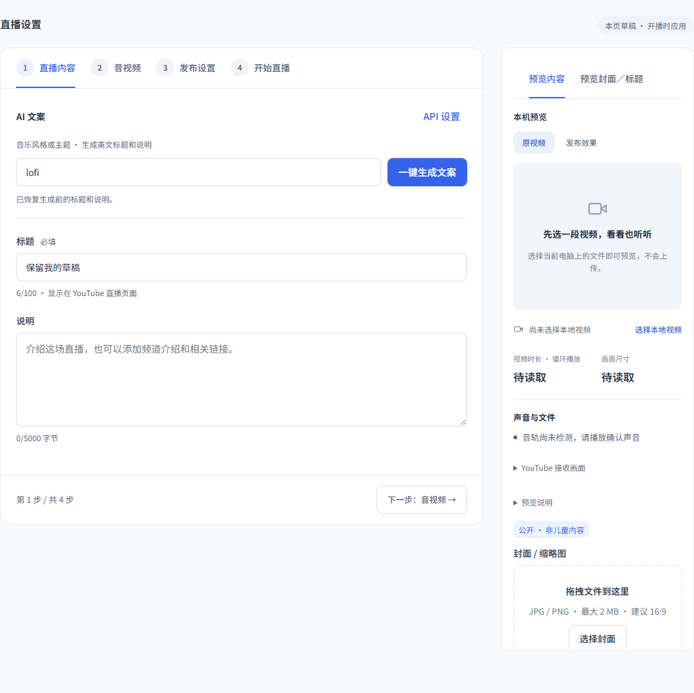
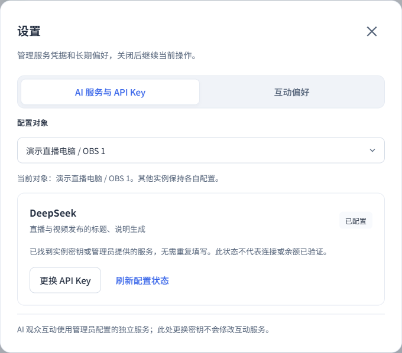
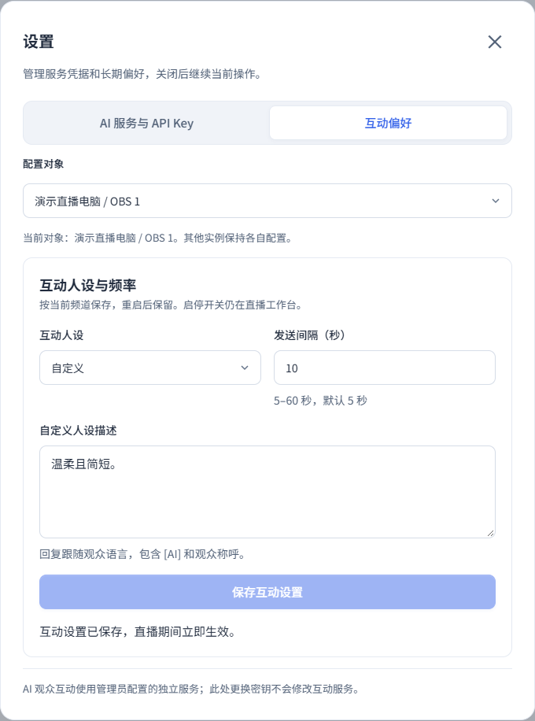
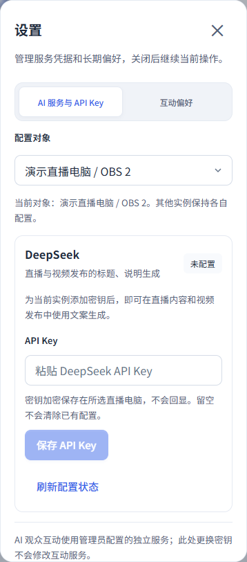
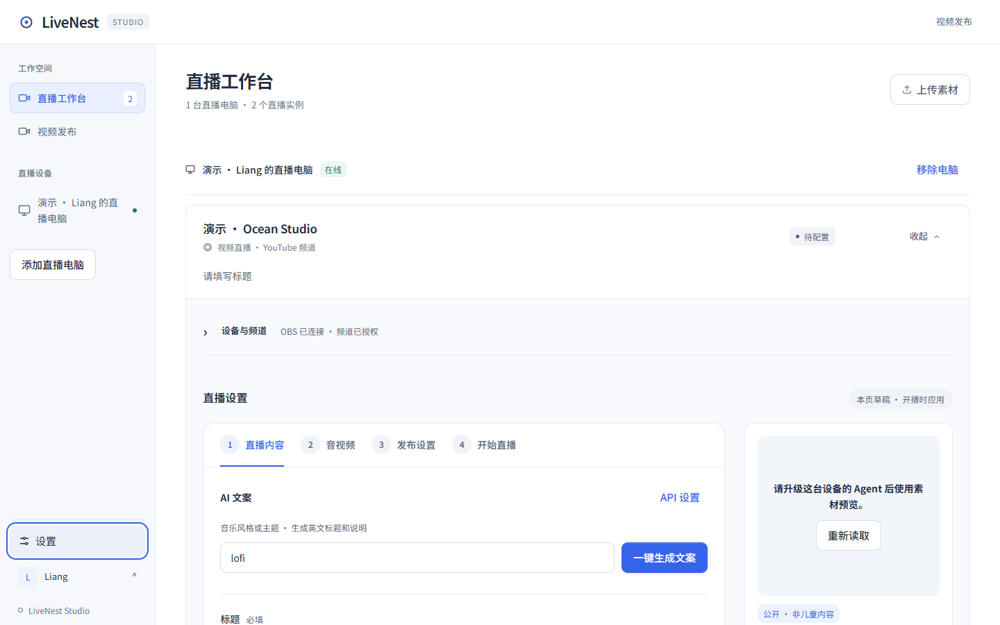
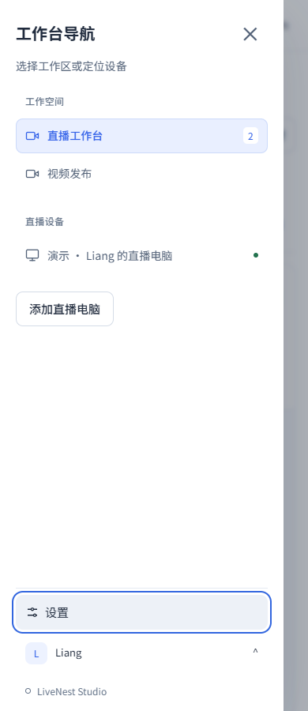

<!-- 文件用途：记录设置区的产品参考、全项目配置归属审计、迁移结果与验收边界。 -->
# 设置归属审计（2026-10-14）

> 2026-10-16：设置中心已改为稳定窗口、左侧分类、右侧滚动；账号共用 AI Key，分类切换保留内存草稿。本文早期截图仅记录归属整理阶段，当前界面与验证见 [设置中心验收](设置中心验收.md)。

## 参考软件与采纳原则

| 官方参考 | 已核对的做法 | 本项目采纳 |
| --- | --- | --- |
| [Cherry Studio 模型服务](https://docs.cherry-ai.com/pre-basic/providers.md) | 在设置 → 模型服务配置 API Key，配置与日常对话分离 | 固定设置入口；业务表单仅保留生成及配置快捷入口 |
| [Dify Model Providers](https://docs.dify.ai/en/self-host/use-dify/workspace/model-providers) | 服务商凭据集中管理，应用使用已配置模型 | 配置状态集中显示；不在每张直播卡片重复摆放密钥表单 |
| [n8n Create and edit credentials](https://docs.n8n.io/build/understand-workflows/create-and-edit-credentials) | 独立凭据管理，在使用位置也可进入凭据配置 | 从文案区带入当前实例，设置后返回原草稿 |

以上只借鉴信息组织，不照搬多服务商市场或多 Key 轮询。LiveNest 当前 API Key 仍按 Agent / OBS 实例保存，不改为全账号共享。现有状态接口只确认配置存在；不能照搬其他软件的“验证成功”字样，实际连接与余额在用户主动生成时验证。

## 全项目审计与处置

审计范围为 `src/app`、`desktop/app` 的用户与管理员界面，并核对对应 API、Agent 配置读写和既有文档。区分长期配置、当前任务参数、实时控制和诊断信息；并非把所有带“设置”字样的内容搬进同一窗口。

| 区域 / 项目 | 原归属与问题 | 最终归属 / 处理 |
| --- | --- | --- |
| 文案 DeepSeek API Key | 嵌套在生成工具的折叠区，低频配置占用内容编辑流程 | **迁移**到左侧栏底部「设置 → 文案生成」；生成区「API 设置」直达当前实例 |
| 文案生成主题、生成及撤销 | 核心动作藏在标题和说明之后的折叠区 | **调整**到直播内容顶部常驻；生成按钮为「一键生成文案」 |
| 互动人设、补充描述、发送间隔 | 跨场次保存，却嵌在实时互动面板中 | **迁移**到「设置 → 观众互动」；面板保留「互动设置」快捷入口 |
| 管理员显示时区 | 浏览器持久偏好表单常驻监控标题栏 | **迁移**到总览的「显示设置」；沿用原存储键，不影响排期或系统时区 |
| 发布模板、默认文案规则 | 已在发布配置独立编辑器 | 保留于发布侧栏的设置分组，补上清晰的「设置」标题；模板 AI 区带入当前实例打开 API 设置；侧栏底部提供统一设置入口 |
| 发布账号与 OAuth 撤销 | 已在发布账号及授权与数据区域 | 保留独立账号设置，避免混入 API Key 表单或改变授权影响范围 |
| 发布策略 / 并发 / 配额 | 管理员专用页面 | 保留管理员区域，不向客户设置暴露 |
| 当前批次排期、语言与发布确认 | 当前任务参数与提交授权 | 保留发布向导；修改长期模板不能改变已确认的计划快照 |
| 当前直播标题、说明、封面、公开范围、儿童内容、播放列表 | 当前场次参数 | 保留四步直播流程 |
| AI 互动启停、重试、状态、计数与记录 | 即时操作与运行结果 | 保留互动面板；启停使用最新保存的人设与频率，不重置偏好 |
| OBS / YouTube 连接状态、重新授权 | 目标设备的连接诊断与恢复 | 保留「设备与频道」独立区域；正常状态不并入密钥设置 |
| 素材选择、上传、原声开关、媒体预览 | 当前内容编辑与检查 | 保留素材 / 预览流程；采样信息是诊断结果，不是长期配置 |
| 客户端开机启动、数据目录、更新、解除绑定 | 已在本机设置页 | 保留本机设置；网页不能代替本机文件与安装操作 |
| OBS 路径、名称、控制端口、密码 | 已在本机设备配置 / 实例高级设置 | 保留设备配置域，不移动到网页、不读取已有密码 |
| Windows 入站保护修复、技术报告 | 本机检查及显式修复动作 | 保留设备配置诊断入口；不是日常内容参数 |
| 客户账号、密码重置、设备分配 | 管理员专用账号 / 分配区域 | 保留权限边界；不与普通客户服务设置合并 |
| Cloud / Agent 环境凭据 | 部署环境，不在业务表单 | 保留部署层；特别是聊天环境密钥不改成文案实例密钥 |
| 登录账号切换、预览演示页 | 身份操作 / 独立验收工具 | 保留各自入口，不作为业务偏好迁移 |

## 交互与兼容

- 直播、发布与管理员页面的设置和头像统一放在左侧栏底部；设备列表独立滚动，不将账户入口推出屏幕。账户弹层优先向上展开，手机导航抽屉保留底部入口与焦点返回。顶栏不再重复放置头像和设置。
- 设置为共享的模态窗口。打开、关闭不切换路由或卸载直播编辑器，文案草稿与素材选择保留；Escape 关闭并回到触发入口，保存期间阻止关闭、切换实例或设置分类。
- 公共入口要求明确选择配置对象；业务快捷入口带入当前 Agent 和实例。目录来自已鉴权接口；管理员协助客户时沿用当前客户筛选。失效目标不自动回退到其他实例。
- 状态读取失败显示未知，允许重新读取；离线设备不提交配置请求。切换对象销毁上一对象表单并取消未完成读取，旧响应不能覆盖新目标。
- 既有 Key 自动显示“已配置”，无需重新输入。“更换 API Key”才打开密码输入框；保存成功清空，取消或关闭后不保留未保存 Key；不写浏览器存储。
- 原 `deepseek.enc` 和环境密钥优先级、接口、存储位置、OBS / YouTube 授权均不变；没有迁移脚本，不要求重做授权。保存只确认落盘，不伪装成已验证连接。
- 核对 `core/publishing/metadata.ts` 后确认视频发布文案也使用实例文案密钥，因此设置明确说明同时适用于直播与视频发布；AI 观众互动仍只使用独立的环境凭据。
- 互动偏好保存保持原启停状态；将新公开状态同步回运行面板，后续启停不会覆盖刚保存的人设与发送间隔。仅用户点击保存才修改配置。
- 设置中未保存的编辑在关闭或切换对象 / 分类时放弃；业务页面的现有草稿不受影响。实际开播和 OAuth 同意不作为自动化测试。

## 验收

`npm run build` 后运行 `node tests/ai-settings-ui.smoke.mjs`：隔离 Next 服务，所有业务 API 使用合成响应，外部网络禁止。覆盖生成入口、已有 / 缺失配置、密码输入清理、保存失败及重试、目标隔离、离线、迟到响应、草稿保留、失败不覆盖、生成撤销、互动偏好及启停、管理员时区持久化、320 / 390 / 1440px 布局、焦点恢复和页面异常。

`node tests/live-chat-ui.smoke.mjs` 继续覆盖独立互动启停、键盘编辑、旧 Agent 和离线状态。`npm run verify` 为交付必跑门禁。测试使用模拟 Key、设备及频道，不证明真实 DeepSeek、OAuth 或观众消息送达。

本次交付验证结果：

- `npm run verify` 通过：108 个测试文件、1,040 项测试、8 项部署检查，以及类型检查、lint、Next 构建、Agent 构建。
- 设置迁移提交 `f162f90` 的生产构建上，`node tests/ai-settings-ui.smoke.mjs` 与 `node tests/live-chat-ui.smoke.mjs` 均通过；包含保存中锁定目标、分类及 Escape，错误恢复和原入口焦点恢复。
- 最后修改文件的 ESLint 与 `git diff --check` 通过；桌面及 320 / 390px 设置截图已目视检查。
- 账户位置调整后重新通过完整 `npm run verify`；在本地模拟预览检查直播、发布、管理员三个页面 × 1440 / 390 / 320px：左下角位置、长设备列表不挤走账户区、账户菜单向上展开、Escape 焦点恢复、设置与导航抽屉的嵌套关闭、无横向溢出与零页面异常。
- 未运行真实 DeepSeek、OAuth、开停播或客户设备写操作；未部署线上。

截图均为**合成示例数据**：

本次只提交代码与 PR，未合并或部署。当前正式 0.1.14 网页不包含本次迁移；复用已有协议，无需为这项界面调整更换本机客户端。

## 后续全前端精简

2026-10-15 在此配置归属基础上继续整理导航、任务层级、客户端设置与空状态交互。完整矩阵、检测器结果、浏览器证据及发布边界见 [前端 UX 精简审计](前端UX精简审计.md)。
